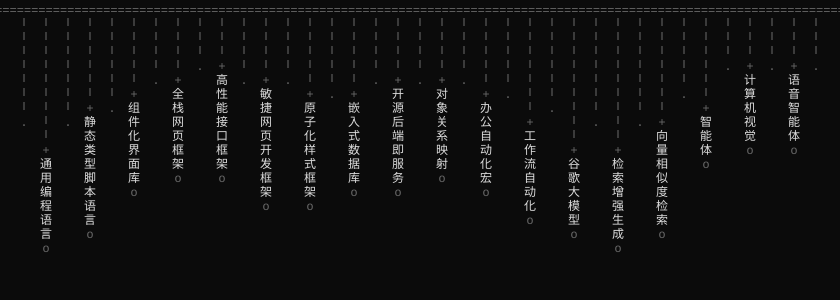

<p align="center">
  
</p>

```
 personal_portfolio                         johnjohnw.github.io/personal_portfolio
 ---------------------------------------------------------------------------------
 IT and Law at QUT. Cyber security, software, automation, and lately robots.

 Nothing on the site is an image. Every figure is a small 3D model raymarched
 on the GPU and printed in characters, sixty times a second.
 No framework, no build step, no dependencies.
```

**Live:** https://johnjohnw.github.io/personal_portfolio/

<p align="center">
  
</p>

That is the arm from the top of the page, running the same code. On the site it
follows your cursor. Hold the mouse button and it closes its gripper on whatever
is under it, and letting go drops or throws it. On a phone, tap something and
the arm goes and picks it up, then tap anywhere else and it carries it there and
puts it down. The ball bounces, the ring rolls, and the steel block lands dead
and makes the arm slower while it is carrying it.

## How a figure gets printed

```
                               +-------------------------------+
  js/scenes.js                 |  pass 1                       |
  a signed distance field      |  raymarch the figure into a   |
  for each figure, and the --> |  small texture, 2 x 2 samples |
  maths that moves it          |  to every character cell      |
                               +---------------+---------------+
                                               |
                                               v
                               +-------------------------------+       =xo@@@@#xx
  js/glyph.js                  |  pass 2                       |      HMMMMMMM@MHH
  the ramp, and a sheet of     |  one point sprite per cell    |      @MMMMMMMH000
  glyphs cut from the page --> |  reads how bright the texture | -->  oMMMMMMMSxxx
  font                         |  is there and picks a glyph   |       ~x@#MMMOoo+
                               +-------------------------------+
```

Both passes stay on the GPU. Nothing is read back, so a frame costs the main
thread next to nothing.

The ramp is the whole palette. Twenty characters, thinnest to densest:

```
 dark   .`,:;-~=+*ox0OSH#M@   light
```

Press `R` on the site to swap it for a longer one, a sharper one, or one made
of ones and zeroes.

## What is on the page

```
 the arm       two links and a gripper on a bench, with three things to pick up.
               each joint is driven like a motor, with a top speed and a limit
               on how hard it can pull away or brake, so it never snaps. to reach
               the other side it swings over the top and straightens on the way.

 the name      set in a display face off screen, read back as coverage per cell
               and drawn from the dense end of the ramp. the fill drifts, cells
               flicker, and every few seconds a band of rows tears sideways.

 the others    a hummingbird, a bee, and two hands that close the gap while you
               type in the contact form. characters part around the cursor, and
               a click sends a ring out through them.

 the sketches  every project gets a small animated drawing of what it does.
               an ownership chart, controls being ticked off, detection boxes.
               one short function each, in js/sketches.js.

 the chimes    the toolkit, translated into Chinese, hanging off a rail at the
               foot of the page. each thread is a verlet chain with a character
               per node. the cursor and the wind push them about and they ring.
```

<p align="center">
  
</p>

## Keys

| key | does |
| --- | --- |
| `R` | cycle the ramp: standard, letters, sharp, binary |
| `I` | invert the colours |
| `S` | sound on or off |

The same three are in the bar along the bottom of the page. Sound needs one
click or key press first, because browsers insist.

Without WebGL the figures are left out, the chimes fall back to a 2d canvas,
and the rest of the page carries on. With `prefers-reduced-motion` set,
everything is drawn once and stays still.

## Running it

There is nothing to install. Serve the folder with whatever is to hand:

```
python -m http.server 8000
```

Opening `index.html` straight off the disk will not work, because the scripts
are ES modules.

## Finding your way around

```
 .
 |-- index.html
 |-- css/style.css
 |-- js/
 |   |-- main.js        fills in the page and runs the render loop
 |   |-- data.js        all of the content
 |   |-- glyph.js       ramps, the glyph sheet, 2d and WebGL sprite drawing
 |   |-- scenes.js      the four figures: shader source, and how they move
 |   |-- plate.js       runs a figure and prints it as characters
 |   |-- name.js        the name in the hero
 |   |-- sketches.js    one small drawing per project
 |   |-- strands.js     the wind chimes
 |   `-- sound.js       how they ring, and the thud of things landing
 `-- readme/            the pictures on this page and the script that makes them
```

All the words live in `js/data.js`. A project's `sketch` names the drawing it
gets, so a new project is one entry there and, if you want it, one function in
`js/sketches.js`.

To change a figure, edit its `map()` in `js/scenes.js`. Joint positions and
rotations are worked out in js and written into the shader as plain numbers.
Leaving that arithmetic in GLSL made the shaders take seconds to compile.

## About the pictures on this page

GitHub will not run scripts in a README, so the three pictures above are SVG
files with the characters baked in as text. They are not screenshots.
`readme/build.html` makes them from the code the site itself runs. It
raymarches the arm and turns each frame into characters, and it runs the name
plate into a grid of text the same way. The chimes are the one cheat: here
they only sway, where the real ones have physics. Serve the repo, open that
page, and save what it gives you.

## Deploy

GitHub Pages, straight from the root of `main`.

```
      |
      |
  //\(oo)/\\      "With great power comes great responsibility."
```
